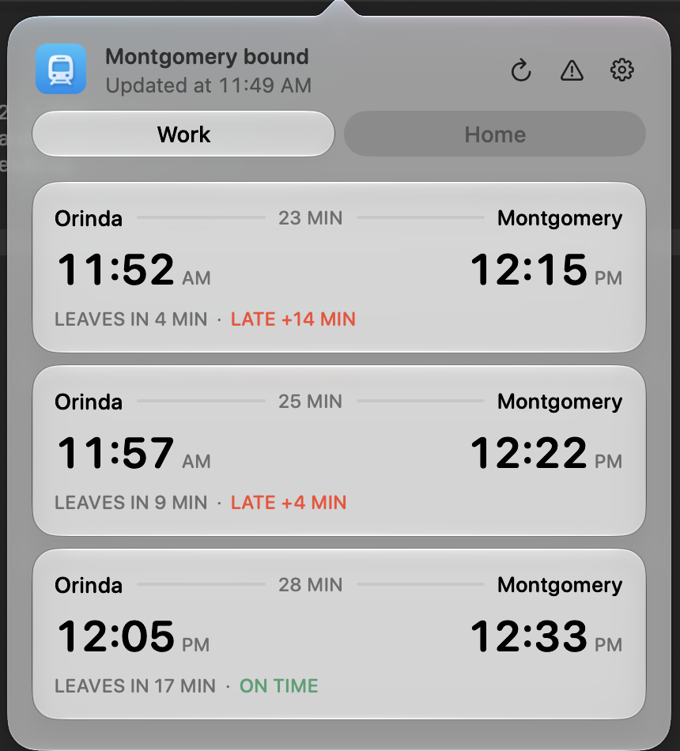
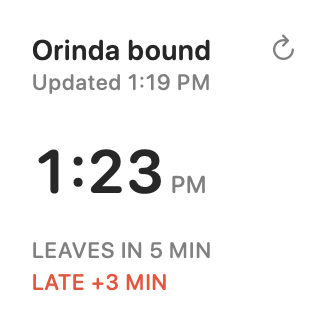
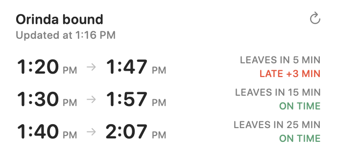
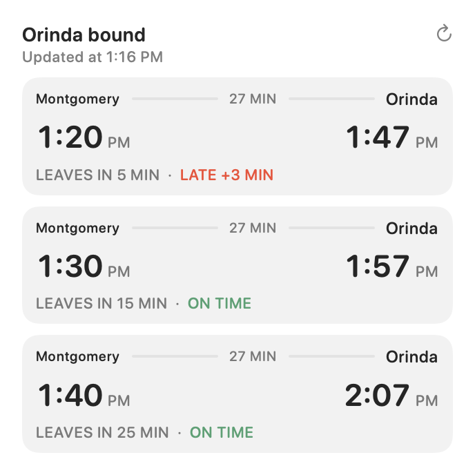
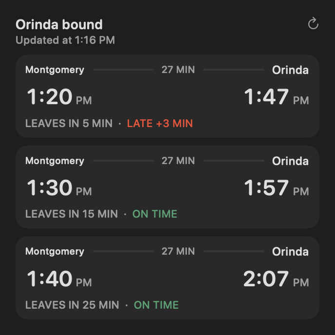

# Bart

Bart is a small Mac app that tells you when your next BART train leaves. It lives in the menu bar and comes with a desktop widget. You pick your two stations, and Bart shows the next three direct trains between them with live delays.

<p align="center">
  
</p>

Requires macOS 14 or later. You don't need a BART account or any setup.

## Install

1. Download **Bart-x.y.z.dmg** from the [latest release](https://github.com/mattbond21/bart-mac/releases/latest).
2. Open the DMG and drag **Bart** into **Applications**.
3. Open Bart. macOS will warn that it can't check the app for malicious software, because Bart isn't notarized by Apple. To allow it:
   - Open **System Settings → Privacy & Security**, scroll down, and click **Open Anyway** next to the message about Bart.
   - Or run this once in Terminal: `xattr -dr com.apple.quarantine /Applications/Bart.app`

You only need to do this the first time. A train icon then appears in your menu bar.

## Using Bart

Click the train icon to see the next three trains. Hover over it to see how long until the next one leaves.

- **Work / Home** sets your direction. *Work* shows trains from your home station to your work station, and *Home* shows the reverse. Before noon Bart picks Work, and after noon it picks Home. If you choose one yourself, Bart sticks with it for the rest of the day.
- Each card shows when the train reaches your station, when it reaches your destination, the ride time, and a **LEAVES IN** countdown.
- Delays appear in red, such as **LATE +4 MIN**. **ON TIME** means BART is tracking the train live. **SCHEDULED** means there's no live data yet, so the time comes from the timetable.
- The **⟳** button refreshes, and **⚠** shows BART service advisories. Bart also refreshes every 30 seconds and when your Mac wakes.

All times are Pacific time.

### Change your stations

Click the **gear → Settings…**, pick your **Work** and **Home** stations from the full list of 50 BART stations, then click **Save stations**. The defaults are Montgomery and Orinda. You can also turn on **Launch at login** here.

Bart only shows direct trains. If your trip needs a transfer, it tells you so and links to BART's trip planner.

## Desktop widget

<p>
  
  
</p>
<p>
  
  
</p>

1. Control-click the desktop and choose **Edit Widgets**.
2. Search for **Bart** (the widget is called **Bart trains**).
3. Drag it onto your desktop. It comes in small, medium and large sizes.

The widget follows the same stations and direction as the menu bar app, and keeps working when the app is closed. macOS decides how often widgets refresh, so press the widget's **⟳** button when you're about to leave.

## Updates

Bart checks for new versions automatically and asks before installing one. To check yourself, click the **gear → Check for Updates…**.

## Where the data comes from

Bart reads BART's public feeds directly. Nothing is sent anywhere else.

- [BART GTFS Realtime](https://www.bart.gov/schedules/developers/gtfs-realtime) for live arrival and departure predictions
- [BART trip planner API](https://api.bart.gov/docs/sched/depart.aspx) for scheduled direct trains
- [BART advisories](https://api.bart.gov/docs/bsa/bsa.aspx) for service notices

Bart is an independent app and isn't affiliated with BART. Predictions can change or disappear without notice. A scheduled train won't show a delay until BART starts tracking it live.

---

## Development

You need full Xcode and [Tuist](https://tuist.dev).

```sh
swift test                           # run the tests
./scripts/build-app.sh --install     # build, install to ~/Applications and launch
```

`build-app.sh` generates the Xcode project with Tuist, builds the app and its WidgetKit extension, signs Sparkle's helper tools, then the widget, then the app, and gives each build a new build number. With `--install` it replaces `~/Applications/Bart.app`, registers the widget and relaunches the app. The widget has to be built as a real Xcode app extension; compiling it with `swiftc` produces an extension that macOS won't load.

Builds are signed with the Apple Development certificate for team `5ERD8L276B`, and the app and widget share a team-prefixed app group (`5ERD8L276B.com.mattbond.bart.shared`). To build under a different team, change the team and app group in both `Configuration/*.entitlements`, the `BARTAppGroup` value in `Configuration/Bart-Info.plist` and the fallback in `SharedBoard.swift`, and set `BART_SIGNING_IDENTITY` to your signing identity.

Useful commands:

```sh
# Print live predictions and the widget's shared cache
~/Applications/Bart.app/Contents/MacOS/Bart --diagnose

# Check the widget extension is registered
pluginkit -m -A -D -v -i com.mattbond.bart.widget
```

### Releasing an update

```sh
scripts/release.sh 2.3.0 "Short note about what changed"
```

This builds the app and packages `Bart-2.3.0.dmg`. It signs the DMG with the Sparkle key in your login keychain and writes `appcast.xml`. Then it commits the version bump, tags `v2.3.0`, and publishes a GitHub release with both files attached. Installed copies read the feed at `https://github.com/mattbond21/bart-mac/releases/latest/download/appcast.xml`, so they see the new version within a day, or right away from **Check for Updates…**.

The Sparkle private key lives only in this Mac's login keychain (generate it with `generate_keys` from Sparkle). Back it up with `generate_keys -x sparkle-key.txt` and store the file somewhere safe. Without that key, existing installs can't verify, and won't accept, any future update.
